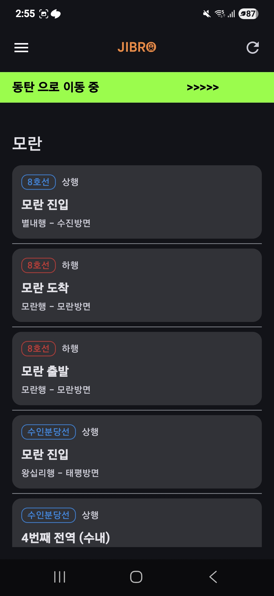
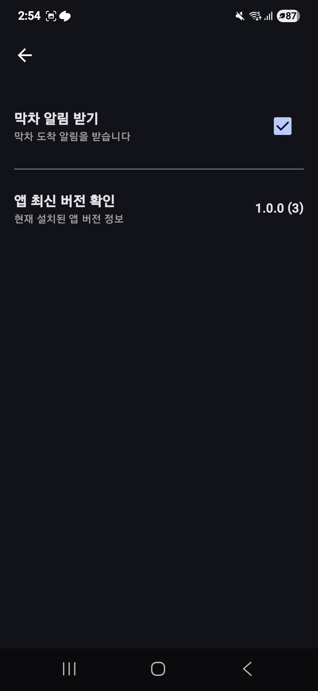
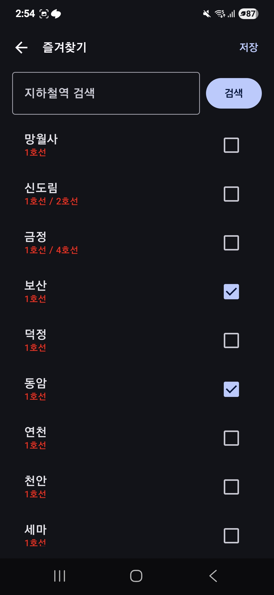
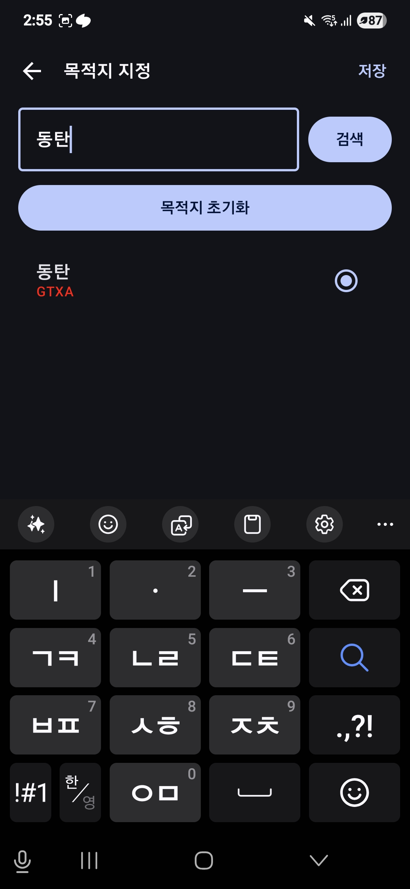
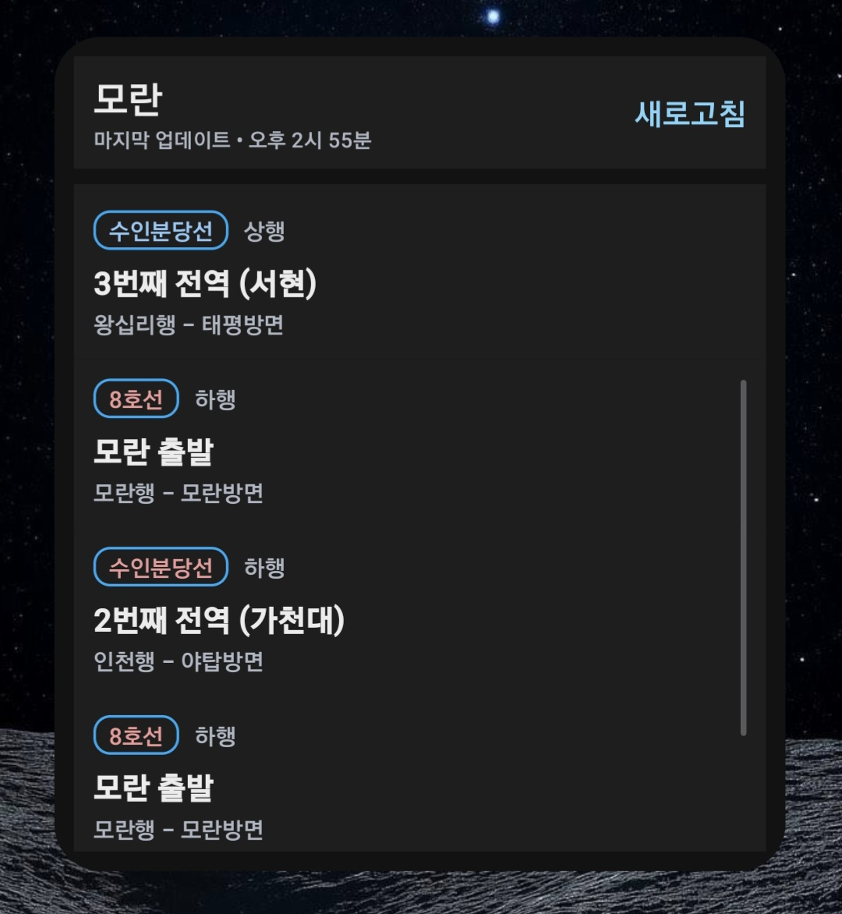

# Jibro
인근 지하철역의 도착 정보를 확인하고 막차, 목적지 도착 알림을 받을 수 있는 서비스입니다.<br />
<p align="left">
  <a href="https://play.google.com/store/apps/details?id=com.windrr.jibrro">
    
  </a>
</p>
<br />

## 개발 시작

Android Studio에서 [jibrro](./jibrro)를 Gradle 프로젝트로 엽니다. 현재 설정은 JDK 17, Android SDK 35, Gradle Wrapper 8.13, AGP 8.11.2, Kotlin 2.3.0을 사용합니다. SDK를 찾지 못하면 `jibrro/local.properties`에 `sdk.dir`을 설정합니다.

```bash
cd jibrro
./gradlew :app:assembleDebug :app:testDebugUnitTest
```

- 기본 디버그 빌드와 단위 테스트에는 API 키나 Firebase 설정이 필요 없습니다. 실시간 도착 조회를 사용하려면 환경 변수 또는 `jibrro/local.properties`에 `SUBWAY_API_KEY`를 설정합니다. [서울 열린데이터광장](https://data.seoul.go.kr/dataList/OA-12764/F/1/datasetView.do)
- Firebase를 사용하는 빌드는 `jibrro/app/google-services.json` 또는 변형별 `jibrro/app/src/{debug,release}/google-services.json`을 읽습니다. 릴리스 빌드에는 서울시 API 키와 릴리스용 Firebase 설정이 필요합니다.
- 실서버 테스트는 인증키를 설정한 뒤 `JIBRO_RUN_LIVE_TESTS=1 ./gradlew :app:testDebugUnitTest --tests '*SubwayApiServiceIntegrationTest' --rerun-tasks`로 실행합니다. 정상 응답 테스트는 강남역에 실제 도착 정보가 있는 운행 시간대에 실행합니다. 예전 테스트 파일에 들어 있던 키는 Git 이력에 남으므로 사용 중인 키라면 재발급합니다.

## Android 귀가 경로

홈 화면에서 **집 설정**을 눌러 도로명 주소, 지하철역 또는 현재 위치를 선택합니다. 주소 검색은 Android의 지오코더를 사용하며, 지오코더가 없어도 앱에 포함된 역 목록에서 선택할 수 있습니다. 집은 기기에 저장하고 경로를 조회할 때 현재 위치와 집의 좌표를 ODsay로 보냅니다. 위치 권한은 경로를 볼 때 요청하고, 막차 알림 권한은 설정에서 알림을 켤 때 요청합니다.

| 기능 | 서비스 | 개발 설정 |
| --- | --- | --- |
| 지하철·버스 조합, 환승 정보, 예상 소요시간 | ODsay `searchPubTransPathT` | `ODSAY_API_KEY` |
| 수도권 지하철 실시간 도착 | 서울 열린데이터광장 `realtimeStationArrival` | `SUBWAY_API_KEY` |
| 서울 버스 실시간 도착 | 서울특별시 정류소정보조회 `getStationByUid` | `SEOUL_BUS_API_KEY` |
| 경기 버스 실시간 도착 | 경기도 버스도착정보 조회 `getBusArrivalListv2` | `GYEONGGI_BUS_API_KEY` 또는 `SEOUL_BUS_API_KEY` |

1. [ODsay LAB](https://lab.odsay.com/guide/guide)에서 개인 개발용 애플리케이션을 등록할 때 **Basic**을 선택하고, Android 플랫폼에 패키지명 `com.windrr.jibrro`를 등록합니다. 무료 Basic은 일 30건이며 기간 제한이 없습니다. 발급 키를 `ODSAY_API_KEY`로 설정합니다. [Basic 한도 공지](https://lab.odsay.com/community/noticeView?seq=370)
2. [서울 열린데이터광장의 지하철 실시간 도착정보](https://data.seoul.go.kr/dataList/OA-12764/F/1/datasetView.do)에서 지하철 인증키를 신청합니다. 기존 유효한 키가 있으면 `SUBWAY_API_KEY`를 그대로 사용합니다.
3. 서울 버스 실시간 도착을 사용하려면 [공공데이터포털의 서울특별시 정류소정보조회 서비스](https://www.data.go.kr/data/15000303/openapi.do)에서 활용을 신청하고 **Decoding 인증키**를 `SEOUL_BUS_API_KEY`로 설정합니다. Retrofit이 요청 시 한 번 인코딩합니다.
4. 경기 버스 실시간 도착을 사용하려면 [공공데이터포털의 경기도 버스도착정보 조회](https://www.data.go.kr/data/15080346/openapi.do)에서 별도로 활용을 신청합니다. 서울 버스와 같은 인증키를 사용하면 추가 키 설정이 필요 없습니다. 다른 인증키를 사용하면 **Decoding 인증키**를 `GYEONGGI_BUS_API_KEY`로 설정합니다.

키를 환경 변수 또는 Git에서 제외된 `jibrro/local.properties`에 넣고 앱을 다시 빌드합니다.

```properties
ODSAY_API_KEY=발급받은_ODsay_키
SUBWAY_API_KEY=발급받은_지하철_키
SEOUL_BUS_API_KEY=발급받은_Decoding_키
```

대중교통 조합은 예상 소요시간순으로 표시합니다. 첫 탑승 버스가 모두 운행 종료인 경로는 목록 뒤에 표시합니다. 각 카드에서 탑승역·정류장, 첫 차량의 실시간 도착 정보, 환승 지점과 갈아탈 노선, 최종 하차 지점을 바로 확인할 수 있습니다. 가장 가까운 지하철역의 도착 목록도 별도로 표시합니다. 서울·경기 버스는 정류소와 노선 식별자가 모두 일치할 때 도착 정보를 표시합니다. 실시간 데이터가 없는 경우에도 대중교통 조합과 환승 정보는 표시됩니다.

대중교통 비교를 계산할 때 ODsay를 한 번 호출합니다. 실시간 도착은 지하철·버스 노선에 해당하는 서울시 또는 경기도 API에서 조회합니다. 광고를 포함한 공개 배포에는 Basic 적용 범위를 ODsay에 확인합니다. [ODsay 서비스 유형](https://lab.odsay.com/contact/contact?act=srvc)

직접 연결은 로컬 검증용입니다. 서울 지하철과 서울 버스의 현재 직접 연결 주소는 HTTP이며, 앱에 포함된 키는 APK에서 확인할 수 있습니다. 배포 전에는 인증키를 백엔드에서 관리하고 앱이 HTTPS로 요청하는 구성을 권장합니다.

### Android 홈 일러스트

내장 ImageGen으로 [열차 고양이 도트 일러스트](./jibrro/app/src/main/res/drawable-nodpi/jibro_train_cat.png)를 생성했습니다.

<details>
<summary>이미지 생성 프롬프트</summary>

> Use case: stylized-concept. Asset type: compact Android home-screen pixel art mascot sticker. One tiny cream-white marshmallow cat commuter, with upright ears, pink cheeks and a dark teal crossbody satchel, riding in a small front-facing mint-teal Korean metro train. The cat is clearly visible waving from the single wide train windshield. The train and cat form one unified small silhouette, centered and tightly framed with a little transparent margin. Hand-placed chunky 16-bit video-game pixel art on a visibly regular coarse square grid, hard pixel edges and a dark evergreen 1-pixel outline, no smoothing, no gradients. Limited palette evergreen, mint teal, butter cream, warm coral. Very simple big shapes that read at 100 dp. Exactly one sticker, truly transparent alpha around the subject. No background scene, pedestal, shadow outside the sprite, frame, letters, numbers, labels, logos, watermark or UI.

</details>

## Kotlin Multiplatform과 iOS

| 모듈 | 역할 |
| --- | --- |
| [`:app`](./jibrro/app) | Android 앱. Compose, Hilt, Retrofit, Room, DataStore, 위치 서비스, WorkManager, Glance를 사용합니다. |
| [`:shared`](./jibrro/shared) | Android와 iOS에 공통으로 쓰는 역 모델, 역 목록 인터페이스, 역 검색, 최근접 역 계산. Android는 Hilt를 통해 공유 유스케이스를 사용합니다. |
| [`:ai-scaffolder`](./jibrro/ai-scaffolder) | 별도의 JVM 개발 도구. 앱 기능과 iOS 이식 범위는 `:app`과 `:shared`입니다. |

Apple Silicon Mac에서 iOS 디버그 프레임워크를 생성합니다. `JibroShared.framework`는 `jibrro/shared/build/bin/<target>/debugFramework/`에 생성됩니다.

```bash
cd jibrro
./gradlew :shared:linkDebugFrameworkIosSimulatorArm64 :shared:linkDebugFrameworkIosArm64
```

첫 iOS 앱은 SwiftUI로 만들고 `JibroShared`를 Xcode 프로젝트에 연결하는 방향을 제안합니다. 역 검색 화면부터 연결하고 위치 권한을 허용했을 때 주변 역을 표시하면, 네트워크 연동과 별개로 KMP 호출 및 화면 동작을 먼저 검증할 수 있습니다. 위 프레임워크는 Xcode 27.2에서 빌드했습니다. Kotlin 2.3.0의 공식 호환표에는 Xcode 26.0이 기재되어 있으므로 Kotlin/Native 연동에 문제가 생기면 호환표를 확인합니다. [Kotlin 호환표](https://kotlinlang.org/docs/multiplatform/multiplatform-compatibility-guide.html), [Xcode 직접 연동](https://kotlinlang.org/docs/multiplatform/multiplatform-direct-integration.html)

### 다음 구현 순서

1. **역 검색과 즐겨찾기**. Android는 번들 역 목록을 Gson으로 읽습니다. iOS도 같은 목록으로 검색을 시작하고, 역의 표시 이름과 노선별 식별자를 분리합니다. 현재 목록의 785개 항목에서 119개 이름이 중복됩니다. Android는 기존 Room DB `news_db`의 즐겨찾기를 업그레이드 후에도 읽을 수 있는지 검증합니다.
2. **실시간 도착 정보**. 서울시 제공 API는 HTTP를 안내하고 인증키가 URL 경로에 들어갑니다. iOS 앱에는 HTTPS 엔드포인트를 사용하고, 직접 HTTPS 연동이 확인되지 않으면 서버 프록시에서 키와 캐시를 관리하는 방안을 검토합니다. 공유 계층에는 응답 모델, 제공자 오류 판별, 갱신 시각을 두고 통신 코드 공유가 필요해지면 Ktor를 검토합니다. Android의 현재 응답 변환은 HTTP 성공 여부를 먼저 보므로 제공자 오류, 빈 응답, 오프라인을 각각 처리해야 합니다. [서울시 API 명세](https://data.seoul.go.kr/dataList/OA-12764/F/1/datasetView.do), [Apple 전송 보안](https://developer.apple.com/documentation/security/preventing-insecure-network-connections)
3. **막차와 목적지 알림**. Android 막차 작업은 설정이 켜져 있을 때 15분 주기의 WorkManager에서 `lstcarAt` 표시를 확인합니다. 노선과 방향, 자정 이후 운행일을 먼저 검증합니다. iOS의 막차 예약은 확인된 출발 시간에 로컬 알림을 등록하는 방식부터 검토합니다. 시스템이 백그라운드 갱신 시점을 결정하므로 실시간 조회만으로 막차 시각을 보장하기 어렵습니다. 목적지 접근은 Core Location으로 실기기에서 검증합니다. [Apple 백그라운드 실행](https://developer.apple.com/documentation/backgroundtasks/choosing-background-strategies-for-your-app), [Apple 로컬 알림](https://developer.apple.com/documentation/usernotifications/scheduling-a-notification-locally-from-your-app)
4. **위젯**. 앱 내 실시간 도착 조회가 안정화되면 iOS WidgetKit 위젯을 추가하고 마지막 갱신 시각을 표시합니다.

## 프로젝트 구조
<details>
<summary>Android 앱 폴더 개요</summary>

```text
app/src/main/java/com/windrr/jibrro
├── data
│   ├── api
│   │   └── SubwayService.kt
│   ├── db
│   │   ├── SubwayDao.kt
│   │   └── SubwayDatabase.kt
│   ├── di
│   │   ├── DataStoreModule.kt
│   │   ├── DatabaseModule.kt
│   │   ├── LocalDataModule.kt
│   │   ├── NetworkModule.kt
│   │   ├── RemoteDataModule.kt
│   │   └── RepositoryModule.kt
│   ├── model
│   │   ├── AlarmInfo.kt
│   │   ├── CheckStation.kt
│   │   ├── Destination.kt
│   │   ├── ErrorMessage.kt
│   │   ├── RealtimeArrival.kt
│   │   ├── SubwayArrivalResponse.kt
│   │   ├── SubwayInfo.kt
│   │   └── StationListWrapper.kt
│   ├── repository
│   │   ├── datasource
│   │   │   ├── SettingsLocalDataSource.kt
│   │   │   ├── StationDataSource.kt
│   │   │   ├── SubwayArrivalRemoteDataSource.kt
│   │   │   └── SubwayLocalDataSource.kt
│   │   ├── datasourceImpl
│   │   │   ├── SettingsLocalDataSourceImpl.kt
│   │   │   ├── StationDataSourceImpl.kt
│   │   │   ├── SubwayArrivalRemoteDataSourceImpl.kt
│   │   │   └── SubwayLocalDataSourceImpl.kt
│   │   └── repositoryImpl
│   │       ├── AlarmRepositoryImpl.kt
│   │       ├── CheckStationRepositoryImpl.kt
│   │       ├── SettingsRepositoryImpl.kt
│   │       ├── StationRepositoryImpl.kt
│   │       └── SubwayRepositoryImpl.kt
│   └── util
│       └── SubwayInfo.kt
├── di
├── domain
│   ├── di
│   │   └── UseCaseModule.kt
│   ├── repository
│   │   ├── AlarmRepository.kt
│   │   ├── CheckStationRepository.kt
│   │   ├── SettingsRepository.kt
│   │   └── SubwayRepository.kt
│   ├── state
│   │   ├── LocationState.kt
│   │   └── Result.kt
│   └── usecase
│       ├── DeleteStationUseCase.kt
│       ├── GetCheckStationListUseCase.kt
│       ├── GetDestinationUseCase.kt
│       ├── GetLastLocationUseCase.kt
│       ├── GetLastTrainNotificationUseCase.kt
│       ├── GetStationListUseCase.kt
│       ├── GetSubwayArrivalDataUseCase.kt
│       ├── RegisterAlarmUseCase.kt
│       ├── SaveStationListUseCase.kt
│       ├── SetDestinationUseCase.kt
│       ├── SetLastLocationUseCase.kt
│       └── SetLastTrainNotificationUseCase.kt
├── infrastructure
│   ├── AppCore.kt
│   ├── BootReceiver.kt
│   ├── JibroWorker.kt
│   ├── LocationForegroundService.kt
│   ├── LocationHelper.kt
│   └── di
│       └── LocationModule.kt
├── presentation
│   ├── activity
│   │   ├── LikeStationActivity.kt
│   │   ├── MainActivity.kt
│   │   ├── SettingsActivity.kt
│   │   ├── SplashActivity.kt
│   │   └── ui
│   │       └── theme
│   │           ├── Color.kt
│   │           ├── Theme.kt
│   │           └── Type.kt
│   ├── alarm
│   │   └── AlarmReceiver.kt
│   ├── component
│   │   ├── AlarmPermissionModal.kt
│   │   ├── BannerAdView.kt
│   │   ├── DestinationBanner.kt
│   │   ├── LocationPermissionDialog.kt
│   │   └── LocationPermissionPreviewModal.kt
│   ├── ui
│   │   └── theme
│   │       ├── Color.kt
│   │       ├── Theme.kt
│   │       └── Type.kt
│   ├── viewmodel
│   │   ├── CheckStationViewModel.kt
│   │   ├── SettingsViewModel.kt
│   │   ├── StationViewModel.kt
│   │   └── SubwayArrivalDataViewModel.kt
│   └── widget
│       ├── ArrivalInfoWidget.kt
│       ├── ArrivalInfoWidgetReceiver.kt
│       ├── action
│       │   └── RefreshAction.kt
│       └── di
│           └── WidgetEntryPoint.kt
└── util
    └── Action.kt
```
</details>

클린 아키텍처를 지향하는 형태로 구성되었습니다.

### Data : 실제 데이터의 저장, 네트워크 통신, 외부 데이터 소스와의 연결을 담당합니다.
  - repository/ : Domain 레이어의 Repository 인터페이스 구현체와 실제 로컬 및 API를 통해 데이터를 가져오는 Source로 구성되어 있습니다.
  - api/ : 서버 API 통신을 위한 Service가 구성
  - db/ : ROOM 데이터베이스와 DAO
  - model/ : 네트워크 통신 및 DB에 사용되는 각종 데이터 모델로 구성
  - util/ : 데이터 관련 유틸리티

### Domain : 외부 라이브러리나 프레임워크에 의존하지 않고, 앱의 비즈니스 로직들로 구성됩니다.
  - usecase/ : 하나의 기능 단위로 비즈니스 로직을 구현
  - repository/ : 데이터 접근을 추상화하는 인터페이스

### Infrastructure : 서비스, 브로드캐스트 리시버 등 안드로이드 시스템과 직접적으로 연관된 기능을 담당합니다.

### Presentation : 사용자 인터페이스(UI)와 관련된 코드들로 구성됩니다.
  - activity/ : 액티비티(화면 진입점)
  - component/ : Jetpack Compose 등 UI 컴포넌트
  - widget/ : 위젯 관련 코드
  - viewmodel/ : 화면 상태 및 UI 로직을 담당하는 ViewModel
<br />

## 사용 기술 스택
  - Retrofit: 서울 지하철 정보 api를 통해 데이터를 수신받고 앱에서 필요한 형태로 변환하는 역할
  - Hilt : 의존성 주입 자동화를 통해 수동으로 객체 생성 등의 보일러 플레이트 감소 역할
  - Room : 사용자가 즐겨찾기로 등록한 지하철 역을 로컬에 저장하고 관리하는 역할
  - Data Store : 사용자의 알람 설정 및 목적지 설정에 대한 정보를 로컬에 저장하고 관리하는 역할
  - WorkManaer : 백그라운드로 사용자 인근 지하철 역 도착 정보를 주기적으로 확인하여 막차 정보에 따라 알람을 보내는 역할
  - Compose & Glance : 인앱 UI 및 위젯을 구현하는데 사용
<br />

## 화면별 주요 기능
### 메인화면

<table>
  <tr>
    <td width="360">
      
    </td>
    <td>

**위치 기반 기능**
- LocationHelper를 사용해 사용자의 현재 위치(위도, 경도)를 가져옵니다.
- 가장 가까운 지하철 역을 찾아 그에 대한 도착 정보 목록을 가장 최상단 섹션으로 보여줍니다.

**즐겨찾기 기반 지정 지하철역 도착 정보 목록 제공**
- CheckStationViewModel을 통해 사용자가 저장한 즐겨찾는 역 목록을 관리합니다.
- 저장된 역 목록을 DB에 저장된 순서대로 섹션 구분하여 LazyColumn으로 보여줍니다.
- SubwayArrivalDataViewModel을 사용해 지하철 도착 정보를 가져오고 Card 아이템으로 표시합니다.
- 막차의 경우 우측 상단 스티커 라벨을 Card에 추가 표시합니다.

**목적지 이동 중 표시**
- SettingsViewModel을 통해 DataStore에서 등록된 목적지가 있는 검사하고 포그라운드 서비스 및 배너 표시 설정을 관리합니다.
- DestinationBanner 컴포넌트를 통해 이동 중이라는 정보를 애니메이션 스타일로 나타냅니다.

**사이드 메뉴**
- DismissibleNavigationDrawer로 사이드 메뉴를 표시합니다.
- 설정, 즐겨찾는 역 관리 등의 기능에 접근할 수 있습니다.

**데이터 동기화**
- 상단 수동 동기화 버튼을 통해 현재 목록에 지정된 지하철 역들의 모든 최신 도착 정보를 수신 받을 수 있습니다.
  
    </td>
  </tr>
</table>

### 설정 화면

<table>
  <tr>
    <td width="360">
      
    </td>
    <td>

**앱 버전 정보 표시**
- packageManager를 사용해 앱 정보를 가져오고, 현재 설치된 앱의 버전 이름과 버전 코드를 표시합니다.
- 클릭 시, Jibro의 플레이 스토어 화면으로 이동합니다.
  
**막차 알림 설정**
- CheckBox 클릭으로 SettingsViewModel을 통해 막차 알림 설정을 관리합니다.
- 해당 Bool 값을 저장함으로서 AlarmReceiver에서 필요에 따라 가장 가까운 지하철 역에 막차 정보가 뜨는 순간 알림을 팝업합니다.
  
    </td>
  </tr>
</table>

### 즐겨찾기 지정 화면

<table>
  <tr>
    <td width="360">
      
    </td>
    <td>

**즐겨찾기 선택 기능**
- 다중 선택이 가능한 체크 박스 리스트로 사용자가 원하는 지하철 역을 즐겨찾기로 등록해두고, 메인화면에서 도착 정보를 확인할 수 있습니다.
- 저장 버튼을 클릭하면서 CheckStationViewModel을 통해 즐겨찾기 목록을 관리합니다.
- 빠른 저장을 위해 지하철 역 검색 기능을 제공합니다.
  
    </td>
  </tr>
</table>

### 목적지 지정 화면

<table>
  <tr>
    <td width="360">
      
    </td>
    <td>

**목적지 선택 기능 제공**
- 라디오 버튼 형식으로 하나의 선택만 가능하도록 지원합니다.
- 목적지 선택 후, 저장 클릭 시 SettingsViewModel을 통해 저장됩니다.
- 목적지 초기화 버튼을 통해 기존 목적지 정보를 Clear 할 수 있습니다.
- 즐겨찾기와 동일한 화면 공유를 통해 역시 검색 기능을 제공합니다.
  
    </td>
  </tr>
</table>

### 인근 지하철 역 도착 정보 위젯

<table>
  <tr>
    <td width="360">
      
    </td>
    <td>

**현재 위치 기반 역 조회**
- LocationHelper를 사용해 사용자의 현재 위치를 가져옵니다.
- GetClosestStationUseCase 역 목록을 로드하고, 가장 가까운 역을 찾습니다.

**도착 정보 조회**
- GetSubwayArrivalDataUseCase를 사용해 선택된 역의 실시간 도착 정보를 가져온 뒤, LazyColumn으로 목록을 표시합니다.
- Result 타입을 사용해 로딩, 성공, 실패 상태를 처리하고 그에 따른 UI가 갱신됩니다.

**수동 동기화 기능**
- 새로고침 버튼을 통해 RefreshAction을 RefreshAction을 호출하고, Widget Update를 통해 최신 데이터로 갱신합니다.
- 마지막 업데이트 시간을 표시하여 사용자에게 데이터 최신화 여부를 확인 가능하도록 지원합니다.
  
    </td>
  </tr>
</table>

## 추후 추가 기능 및 수정 사항
- Widget Init 상황에서 즉시 데이터 Fetch 안되는 문제 처리
- LikeStationActivity UI 개선
- 최근 검색 목록 시스템 구성
- TTS 기반 목적지 알림 구현
